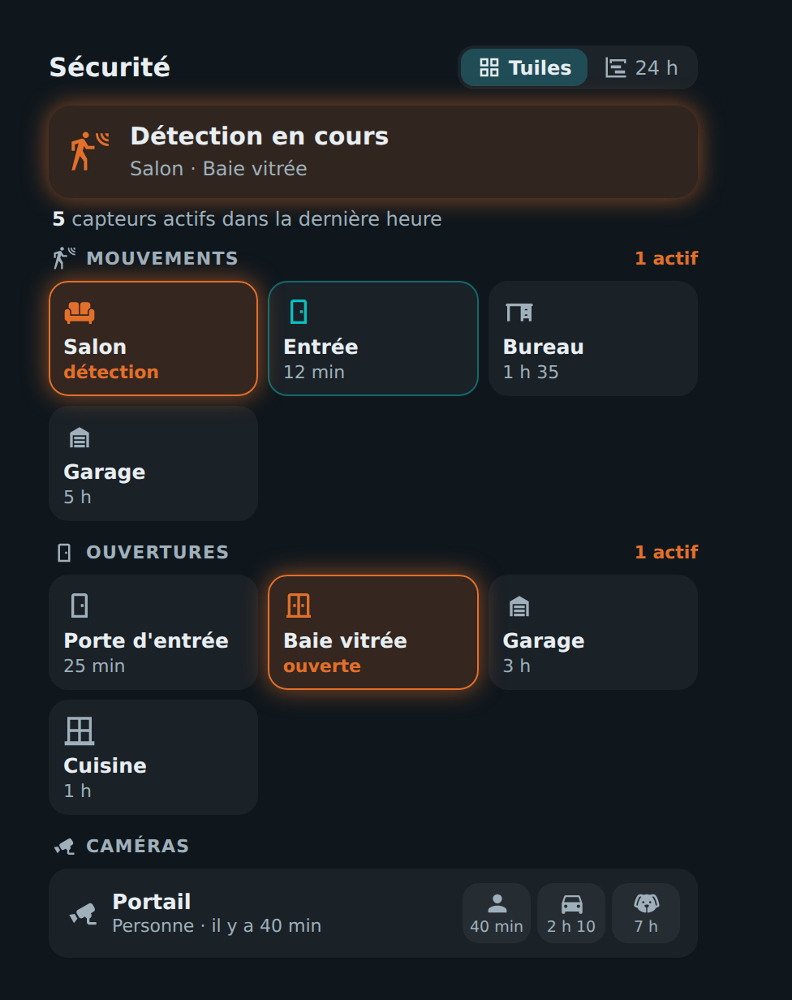
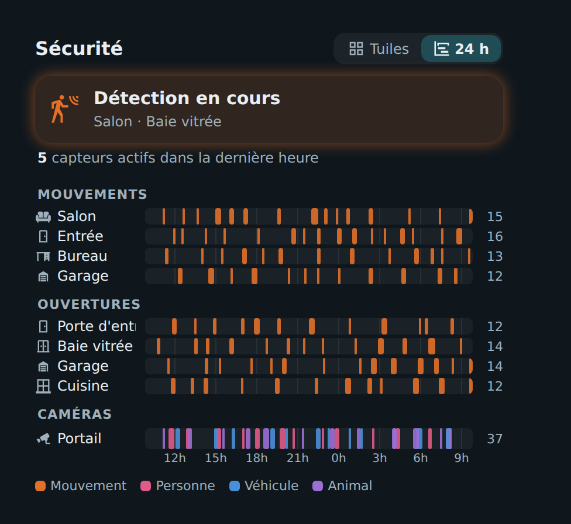
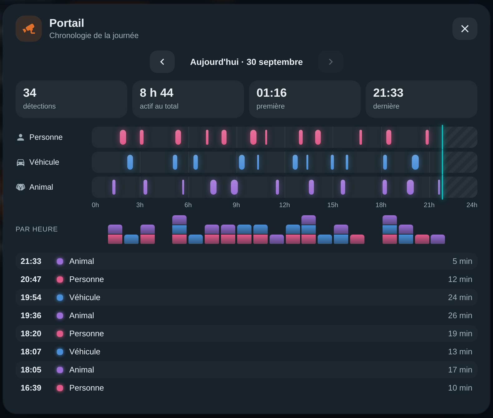

# 🛡️ HOLM Security Card

[](https://hacs.xyz/)


**Mouvements, portes, fenêtres et détections caméra au même endroit : ce qui se passe maintenant, et tout ce qui s'est passé depuis 24 h.**

HOLM Security Card rassemble vos détecteurs de mouvement, vos capteurs d'ouverture et les détections de vos caméras (personne, véhicule, animal) dans une carte claire, avec **deux vues** : des **tuiles** en direct (« il y a 12 min ») et une **chronologie** de l'activité des dernières heures.

> ✨ **Zéro YAML.** Groupes et capteurs se configurent dans l'éditeur visuel ; la chronologie vient de l'historique de Home Assistant.

### En bref

- 🚨 **Bandeau « Détection en cours »** avec les capteurs actifs, et le nombre de capteurs actifs dans la dernière heure.
- 🧱 **Tuiles** par groupe : état, libellé personnalisable (« ouverte », « détection »), temps écoulé depuis le dernier changement.
- 📷 **Caméras** sur une ligne compacte : dernières détections Personne / Véhicule / Animal.
- 📊 **Chronologie** : chaque détection sur une frise (24 h par défaut), avec le nombre d'événements par capteur et une légende par type.
- 🔎 **Chronologie de la journée au toucher** : un clic sur un capteur (ou sur une caméra) ouvre une fenêtre avec la frise de la journée, les détections par heure, le total, la première et la dernière, et la liste des événements. On remonte les jours précédents avec ‹ ›.
- 🗂️ **Ordre des groupes respecté** : l'affichage suit l'ordre de l'éditeur ; les caméras qui se suivent sont regroupées sous « Caméras ».
- 🎨 Couleur orange pour ce qui est actif, turquoise pour ce qui vient de se produire.

| Tuiles | Chronologie 24 h |
|---|---|
|  |  |

**Chronologie de la journée** (clic sur un capteur ou une caméra)



---

## Installation

### Avec HACS (recommandé)

1. HACS → menu ⋮ → **Dépôts personnalisés**.
2. Ajoutez `https://github.com/kaaribou/holm-security-card`, catégorie **Tableau de bord** (*Dashboard / Plugin*).
3. Recherchez la carte → **Télécharger**.
4. Rechargez la page (Ctrl + F5).

### Manuellement

1. Copiez `dist/holm-security-card.js` dans `config/www/community/holm-security-card/`.
2. **Paramètres → Tableaux de bord → ⋮ → Ressources → Ajouter** : `/local/community/holm-security-card/holm-security-card.js`, type **Module JavaScript**.
3. Rechargez la page.

---

## Utilisation

```yaml
type: custom:holm-security-card
title: Sécurité
hours: 24
groups:
  - name: Mouvements
    icon: mdi:motion-sensor
    entities:
      - entity: binary_sensor.mouvement_salon
        name: Salon
        icon: mdi:sofa
  - name: Ouvertures
    icon: mdi:door
    entities:
      - entity: binary_sensor.porte_entree
        name: Porte d'entrée
        on_label: ouverte
  - name: Portail
    icon: mdi:cctv
    layout: camera                    # ligne compacte Personne / Véhicule / Animal
    entities:
      - binary_sensor.portail_personne
      - binary_sensor.portail_vehicule
      - binary_sensor.portail_animal
```

## Options

| Option | Description | Par défaut |
|---|---|---|
| `title` | Titre | `Sécurité` |
| `view` | Vue à l'ouverture : `tiles` ou `timeline` | `tiles` |
| `hours` | Durée de la chronologie (h) | `24` |
| `show_frame` | Afficher le cadre de la carte | `true` |
| `groups` | Groupes : `name`, `icon`, `layout` (`tiles` ou `camera`), `entities` (**obligatoire**) | — |
| `entities` | Entité, ou `entity`, `name`, `icon`, `on_label` (texte quand actif) | — |

En disposition `camera`, le type de détection est reconnu d'après le nom de l'entité (`person` / `personne`, `vehicle` / `véhicule`, `animal` / `pet`).

## FAQ

| Problème | Solution |
|---|---|
| Chronologie vide | Les capteurs doivent être enregistrés dans l'historique (recorder). |
| Accéder à la fiche du capteur | Dans la fenêtre de chronologie, bouton **Détails du capteur**. |
| La nouvelle version ne s'affiche pas | Videz le cache (Ctrl + F5). |

---

## Un petit merci ?

La carte vous plaît ? Vous pouvez m'offrir une bière 🍺

[](https://paypal.me/kaaribou)

---

## Licence

Code : licence **MIT** — © kaaribou. Voir le [CHANGELOG](CHANGELOG.md).

Fait partie de la collection **HOLM** : [Volets HOLM](https://github.com/kaaribou/volets-holm) · [Climat HOLM](https://github.com/kaaribou/climat-holm) · [Carburant HOLM](https://github.com/kaaribou/carburant-holm) · [HOLM Climate Card](https://github.com/kaaribou/climate-card-holm) · [HOLM Covers Card](https://github.com/kaaribou/holm-covers-card) · [HOLM Navbar Card](https://github.com/kaaribou/holm-navbar-card) · [HOLM Music Card](https://github.com/kaaribou/holm-music-card) · [HOLM Sentinel Card](https://github.com/kaaribou/holm-sentinel-card) · [HOLM Power Flow Card](https://github.com/kaaribou/holm-power-flow-card) · [HOLM Energy Cards](https://github.com/kaaribou/holm-energy-cards) · [HOLM Radiator Card](https://github.com/kaaribou/holm-radiator-card) · [HOLM Floor Card](https://github.com/kaaribou/holm-floor-card) · [HOLM Smoke Card](https://github.com/kaaribou/holm-smoke-card) · [HOLM BG Card](https://github.com/kaaribou/holm-bg-card).
